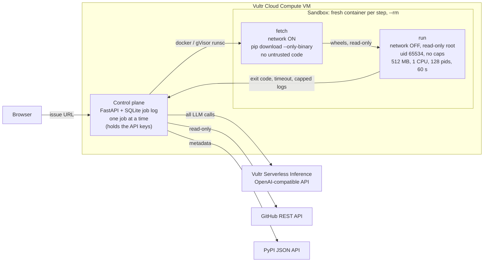

# Repro Room

**Paste a GitHub issue. Get a reproduction you can trust.** A [Nightjar Labs](#license) entry for Vultr Agent Rush ("Blast Radius Zero").

Repro Room reads a public Python bug report, turns the reporter's own snippet into a minimal `repro.py`,
and runs it at the reported version and at the latest PyPI release, each in its own disposable, offline sandbox.
It answers **reproduced / not reproduced / already fixed in vX / still present on latest vX / inconclusive**
with the script, the logs, exit codes and timings, plus a draft comment for the maintainers that you can copy.
Nothing is ever posted anywhere.

The agent writes and runs code it got from strangers on the internet, so the interesting part is the blast radius:
every step runs in a fresh container with no network, no secrets, a read-only root, no privileges and hard
limits, destroyed right after. The built-in **containment drill** proves it with a deliberately hostile script.

## How it works

1. **Read** the issue with the GitHub REST API (read-only; optional read-only token).
2. **Extract** facts with the LLM as validated JSON: ecosystem (Python only), PyPI package, reported version,
   claimed behaviour, symptom (exception / hang / wrong output / crash) and the snippet, verbatim. The package and
   version are checked against PyPI.
3. **Write** `repro.py` from the snippet. Every line the model adds or changes (imports, inputs, stripped `>>>`
   prompts) must end with `# added by Repro Room`, and the UI highlights them; changed lines without the marker
   are flagged. The script must print exactly one marker line: `REPRO: BUG` or `REPRO: OK`.
4. **Run** at the reported version, then at the latest release, each in a fresh sandbox (below).
5. **Repair**: if a run fails for a reason unrelated to the bug (`SyntaxError` in the script, `NameError` raised
   in the script, `ImportError` of a non-target module, or, when the claimed bug is a wrong value, an uncaught
   exception that stops the script before its check), the LLM may rewrite the *script only*, at most twice.
   Every attempt is kept and shown.
6. **Verdict**: deterministic rules in [`reproroom/verdict.py`](reproroom/verdict.py), from exit code, host-side
   timeout, marker lines and the uncaught exception type and where it was raised. Not the LLM. For a claimed hang
   the observable is termination: killed by the wall clock means the bug is present, finishing in time means it
   is not, whatever the script prints. Which lines of `repro.py` were added is also decided by code, by diffing
   against the snippet, not by trusting the model's markers.
7. **Explain**: the LLM writes a short explanation and a draft maintainer comment. The results table and the
   script in the comment are filled in by code, so they match what actually ran.



## Vultr services used

- **Vultr Cloud Compute**: one Ubuntu 24.04 VM runs the whole loop: control plane, Docker (optionally with gVisor
  `runsc`), Caddy for HTTPS.
- **Vultr Serverless Inference**: every LLM call (extraction, script writing, repair, explanation) goes to its
  OpenAI-compatible endpoint `https://api.vultrinference.com/v1` (`LLM_MODEL`, default `glm-5.3`). The client is a
  plain `httpx` call to `/chat/completions`, so any OpenAI-compatible endpoint works for local development.

## Containment model

| Concern | What Repro Room does |
|---|---|
| Process isolation | Untrusted code never runs in the app process or on the host. Each step is a fresh `docker run --rm` (or `podman`), optionally under gVisor (`SANDBOX_OCI_RUNTIME=runsc`). |
| Two phases | **fetch**: network on, but only `pip download --only-binary=:all:` runs (wheels only, so no `setup.py`), no script is mounted. **run**: `--network none`, wheels and script mounted read-only, install with `--no-index`. On the VM, `DOCKER-USER` firewall rules drop all container traffic to the cloud metadata service (`169.254.0.0/16`) and private ranges, so even the fetch phase can reach only the public internet. |
| Secrets | Keys live only in the control plane. Containers get an explicit minimal environment; the script itself is `exec env -i`'d with exactly `PATH HOME LANG PYTHONUNBUFFERED PYTHONDONTWRITEBYTECODE`. The container CLI is started with an allowlisted environment, and podman's proxy forwarding is disabled. |
| Filesystem | `--read-only` root, `--tmpfs /work` (256 MB, the script's `HOME`) and `--tmpfs /tmp` (64 MB). |
| Privileges | `--user 65534:65534`, `--cap-drop ALL`, `--security-opt no-new-privileges`, `--init` reaps orphans. |
| Resources | `--memory 512m --memory-swap 512m`, `--cpus 1`, `--pids-limit 128`, 60 s wall clock enforced **host-side** (kill + remove, exit 124), stdout+stderr capped at 256 KB (truncation is flagged). |
| Lifecycle | Container removed after every step and verified gone; per-job host directory deleted at job end; a janitor removes anything labelled `reproroom` at startup. |
| Records | Per step: sanitised command, flags, image digest, exit code, timeout flag, duration, capped logs. |

The **containment drill** (home page button) runs [`reproroom/fixtures/hostile_repro.py`](reproroom/fixtures/hostile_repro.py)
verbatim in the same sandbox: it dumps the environment and `/proc/1/environ`, tries DNS, raw TCP, HTTPS and
`curl | sh`, looks for the host and the container runtime socket, tries `setuid(0)`, `/etc/shadow` and `mount`,
overwrites system files, fills the disk, fork-bombs, runs `rm -rf ~` and `rm -rf /`, and allocates memory until it is
killed. The job page shows what the attacker observed from inside, next to host-side checks taken before and after
(host canary file hash, `/healthz` latency, leftover containers, whether any control-plane secret value appears in the
sandbox output). All results are observed at run time, not described.

Honest limits: with the default runtime the sandbox shares the host kernel (gVisor narrows that); the fetch phase
can reach any host on the internet, but it only runs pip; the control plane needs Docker access, which is
root-equivalent on the VM, so it is kept small and never executes untrusted code itself.

## Run it locally

Requirements: Python 3.12+, [uv](https://docs.astral.sh/uv/), and Docker or rootless Podman.

```bash
uv sync
docker pull docker.io/library/python:3.12-slim      # or: podman pull ...
export LLM_BASE_URL=https://api.vultrinference.com/v1 LLM_API_KEY=... LLM_MODEL=glm-5.3
export SANDBOX_RUNTIME_CLI=docker                    # or podman
uv run repro-room                                    # http://127.0.0.1:8000
```

`LLM_API_KEY_FILE=/path/to/key` works instead of `LLM_API_KEY`. Any OpenAI-compatible endpoint can stand in for
development, e.g. Gemini's (`LLM_BASE_URL=https://generativelanguage.googleapis.com/v1beta/openai`).
All settings are listed in [`deploy/repro-room.env.example`](deploy/repro-room.env.example).

### Tests

```bash
uv run pytest            # unit + real-sandbox tests (needs docker or podman and network for the fetch phase)
uv run pytest -m live    # end-to-end against GitHub, PyPI and the LLM endpoint in LLM_* (tomlkit#442)
```

The sandbox tests run real containers and assert each hostile behaviour is contained: the fork bomb hits the pids
limit, the network is unreachable in the run phase, a fake `REPRO_ROOM_CANARY_SECRET` set in the control-plane
environment never appears inside, the root is read-only, the memory cap kills, the wall clock kills and the
container is gone afterwards, output is capped. Verdict rules are table-driven; extraction and script parsing use a
fake LLM.

## Deploy on Vultr

On a fresh Ubuntu 24.04 Cloud Compute instance:

```bash
git clone <this repo> repro-room && cd repro-room
sudo ./deploy/setup-vm.sh --gvisor        # or without --gvisor for Docker's default runtime
sudoedit /etc/repro-room/repro-room.env   # set LLM_API_KEY (Vultr Serverless Inference)
sudo systemctl start repro-room
```

The script installs Docker, optionally gVisor, Caddy and uv; creates a `reproroom` service user; installs the app
to `/opt/repro-room`; pulls the sandbox image and checks the limits work; installs the hardened systemd unit
[`deploy/repro-room.service`](deploy/repro-room.service); and serves the app with automatic HTTPS at
`https://<public-ip>.sslip.io` via [`deploy/Caddyfile.template`](deploy/Caddyfile.template). Only ports 22, 80 and
443 are open.

Public-demo abuse limits (env): one job at a time, `MAX_QUEUE`, `RATE_LIMIT_PER_IP` per `RATE_LIMIT_WINDOW`,
`DAILY_JOB_CAP`; only `github.com` issue URLs; only PyPI packages.

## Project layout

```
reproroom/
  app.py        FastAPI app: pages, job API, /healthz, security headers
  jobqueue.py   one-at-a-time worker, queue/rate/daily limits
  pipeline.py   read → extract → write → fetch/run → repair → verdict → explain; the drill
  agent.py      prompts and validated LLM steps
  llm.py        OpenAI-compatible client (httpx), <think>/fence-tolerant parsing
  sandbox.py    container runner: phases, limits, host-side timeout, output cap, janitor
  verdict.py    deterministic run classification and verdict rules
  drill.py      host probe and checks for the containment drill
  sources.py    GitHub issue reader, PyPI lookup
  store.py      SQLite job log
  fixtures/hostile_repro.py, templates/, static/
deploy/         setup-vm.sh, systemd unit, Caddyfile template, env template
tests/
```

## AI-use disclosure

Repro Room was built with AI coding agents (Claude) under the direction of the owner of Nightjar Labs, who chose the
concept, reviewed the design and the security model, and is responsible for the submission. At run time the
product itself uses an LLM (via Vultr Serverless Inference) for extraction, script writing, script repair and the
explanation; the verdict is computed by code.

## License

MIT © Nightjar Labs. See [LICENSE](LICENSE).
